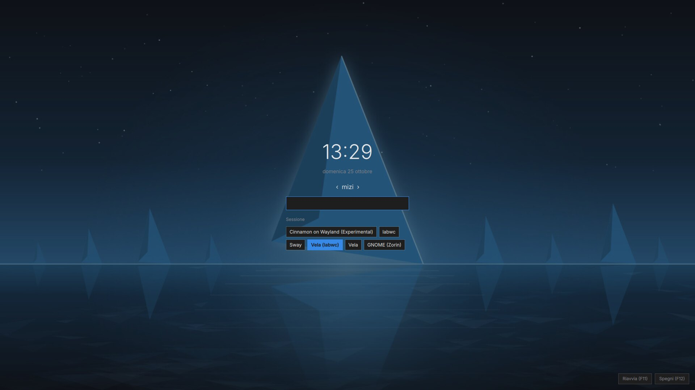
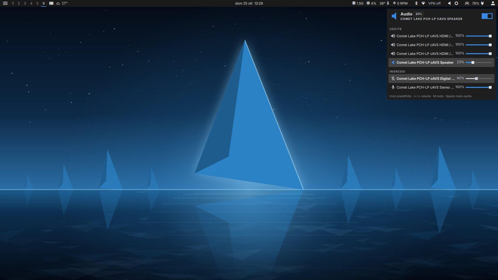
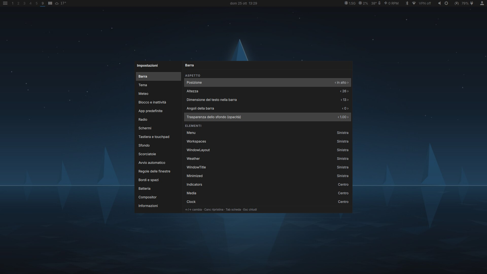

<p align="center"></p>

<h1 align="center">Vela</h1>

<p align="center">Shell minimale per Sway su Void Linux: barra, menu, pannelli, schermata di accesso.<br>Basata su <a href="https://quickshell.org">Quickshell</a>.</p>

> ## ⚠️ Attenzione
>
> **Vela è altamente sperimentale e potenzialmente distruttiva.**
> Tocca la sessione grafica, può modificare impostazioni di sistema (limite di carica della batteria, servizi, schermi,
> sfondo, tema) e il greeter sostituisce la schermata di accesso: un errore può lasciarti **senza login grafico**.
> Provala con un'altra sessione o una console a portata di mano, e **non usarla su un computer di cui non puoi
> permetterti di perdere il lavoro**. Nessuna garanzia, di nessun tipo.

## Cos'è (e cosa non è)

È un **progetto personale, fatto per il mio PC con Void Linux** e per come lo uso io. Funziona lì; altrove non so.

- Puoi usarla liberamente, il codice è aperto (licenza [EUPL-1.2](LICENSE)): **fanne quello che vuoi**, copiala, cambiala, smontala.
- **Non offro supporto.** Niente richieste di aiuto, niente promesse di correzioni o di funzioni nuove. Le issue e le pull request
  possono restare senza risposta, e va bene così.
- Solo Void Linux (glibc, x86_64, runit). Altre distribuzioni non sono né provate né previste.

## Sì, è scritta con l'AI

Gran parte del codice (e di questa documentazione) è scritta con l'aiuto di un assistente AI, [Claude Code](https://claude.com/claude-code),
sotto la mia direzione e con me che provo tutto sul mio PC. Lo dico apertamente, anche se, tra noi, sarebbero fatti miei. Se la cosa
ti disturba, è una ragione legittima per non usarla.

## Com'è fatta

<p align="center">
  <br>
  <em>La schermata di accesso (<code>vela-greeter</code>, per greetd)</em>
</p>

<p align="center">
  <br>
  <em>La barra e il pannello audio</em>
</p>

<p align="center">
  <br>
  <em>Le Impostazioni</em>
</p>

Dentro ci sono: barra, menu/launcher con calcolatrice, pannelli (rete, Bluetooth, audio, schermi, stampanti, servizi, luminosità,
energia, scorciatoie, radio, limite di carica della batteria), notifiche e OSD, Impostazioni, blocco schermo, tema anche per le app Qt,
e una sessione di login «Vela» (Sway) o «Vela (labwc)». Tutto ciò che manca sul sistema (Bluetooth, stampanti, ...) semplicemente sparisce dalla shell.

## Installare

Su Void, dal repository xbps del progetto:

```sh
echo 'repository=https://akamizi.github.io/vela/current' | doas tee /etc/xbps.d/20-vela.conf
doas xbps-install -S vela                 # la shell
doas xbps-install vela-recommended        # (facoltativo) le dipendenze facoltative, per avere tutte le funzioni
doas xbps-install vela-greeter            # (facoltativo) la schermata di accesso: va poi attivata a mano in greetd
```

Al primo `-S` xbps chiede di accettare la chiave del repository, con questa impronta: `90:db:2f:97:18:f1:73:cd:c7:63:81:93:bb:2c:0a:8d`.
Il pacchetto installa anche cinque sfondi in `/usr/share/backgrounds/vela` (predefinito nella sessione Vela: `Vela-5.jpg`).

Il pacchetto non attiva servizi e non tocca `~/.config/sway/config`. `vela-greeter` non cambia `/etc/greetd`: la configurazione
da usare è in `/usr/share/doc/vela-greeter/`. **Prima di attivarlo tieni pronta una console** (Ctrl+Alt+F2) da cui tornare indietro.

Da sorgente: `make` come utente, poi `make install PREFIX=/usr` (richiede `cargo`, `quickshell` ≥ 0.3 e `sway`).

## Documentazione

- [Manuale](docs/MANUAL.md): requisiti, primo avvio, configurazione, ogni pannello, comandi `vela ipc`.
- [Novità per versione](docs/CHANGELOG.md)
- [Greeter](greeter/README.md) · [Pacchetto xbps](packaging/void/README.md) · [Licenze di terze parti](THIRD-PARTY.md)

## Licenza

[EUPL-1.2](LICENSE). Copyright © 2026 Maurizio Cavalletti.
